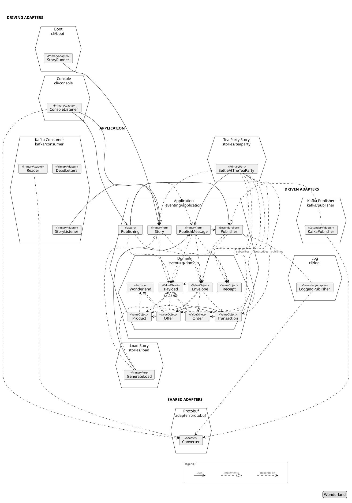
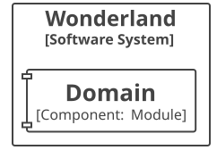
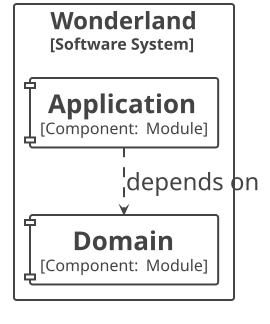
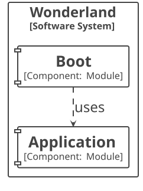
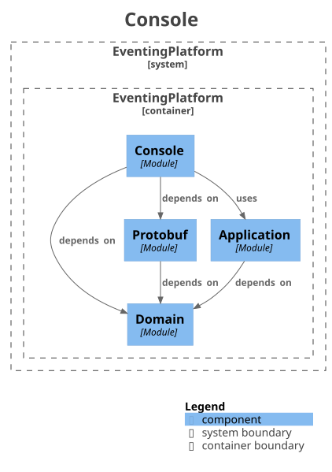
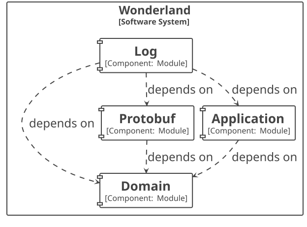
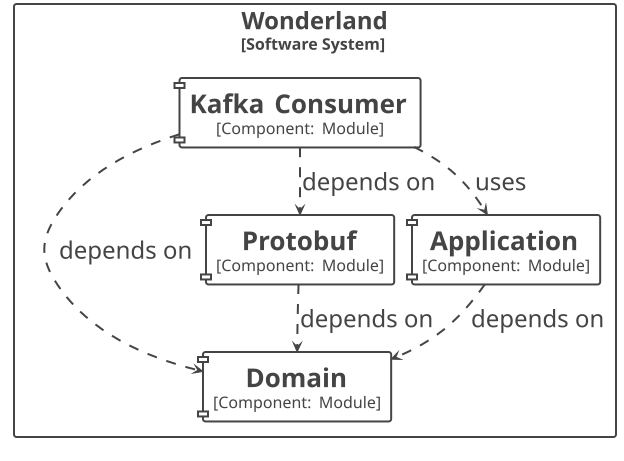
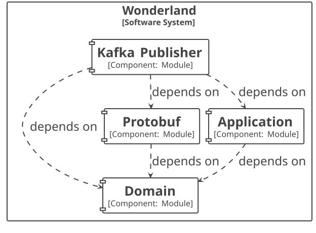
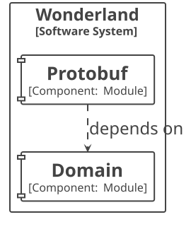
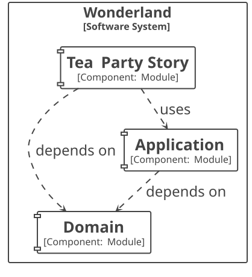

# Architecture discoverability

Here, we experiment a bit with auto disovery of architecture, automated verification of architecture, and automated generation of documentation.
The architecture layers are annotated in the code, and that information is used to:
- verify the architecture (is hexagonal) `make arch-verify`
- generate diagrams and canvases `make arch-gen`



The picture is owing to Alistair Cockburn's classic, [Hexagonal Architecture](https://alistair.cockburn.us/hexagonal-architecture/),
2005: the application in the middle, driving adapters on one side, driven adapters on the other, ports on the
hexagon's edges.

## Architecture Discovery Pipeline

1. **Stereotypes on types and packages.** jMolecules hexagonal annotations name the role of each type:
   `@PrimaryPort` on `Story`, `PublishMessage`, and every story, `@SecondaryPort` on `Publisher`,
   `@PrimaryAdapter` on `StoryRunner`, `ConsoleListener`, and `StoryListener`, `@SecondaryAdapter` on
   `LoggingPublisher` and `KafkaPublisher`. Each adapter package carries its side's stereotype on its
   `package-info.java` as well, so a class in it without one of its own, `Reader`, has the package's role; the
   packages both sides share, `adapter.kafka` and `adapter.protobuf`, carry the unqualified `@Adapter`. Domain
   types carry none.
2. **Modules on packages.** jMolecules `@Module` on the `package-info.java` of `domain`, `application`,
   `adapter.cli.boot`, `adapter.cli.console`, `adapter.cli.log`, `adapter.kafka.consumer`,
   `adapter.kafka.publisher`, `adapter.protobuf`, and each story's package. Spring Modulith takes these as the
   application modules, set by `spring.modulith.detection-strategy=explicitly-annotated` in
   `platform.properties`.
3. **The rule.** `ArchitectureTest` imports the main classes with ArchUnit and runs
   `JMoleculesArchitectureRules.ensureHexagonal()`, a layered architecture whose layers are the stereotypes, at the
   strict depth. It fails when a use case reaches an adapter, an adapter reaches core code that is not a port, a
   driving adapter reaches a driven port, or an adapter reaches an adapter of the other kind.
4. **Module verification.** `ArchitectureDocumentationTest` runs `ApplicationModules.verify()`: no cycles between
   modules, and a module reaches another only through its API package. Steps 3 and 4 are unit tests, so
   `make build` runs them; `make arch-verify` runs the two alone.
5. **Documents.** The same test class carries a tagged writer, run by the Gradle task `generateArchitecture`. It
   runs Spring Modulith's `Documenter` into `docs/generated/architecture/plantuml`: `components.puml`, a UML
   component diagram of the modules and their dependencies, one `.puml` per module with its direct dependencies,
   one `.adoc` canvas per module, and `all-docs.adoc` linking them. Then it runs the `architecture-discovery`
   library. `ModelWriter` reads the classes once into the model, `hexagon.proto`: the modules in their rings,
   placed by the jMolecules stereotypes of their types, their own or their package's, each module with its
   package's stereotypes and its types, each type with its role as its stereotype and its Spring annotations as
   its wiring, `Component`, `Profile(cli)`, a bean method as an entry of its own, `PurseStory.purse` with
   `Bean(KnowWhatIsLeft)` and its parameters, the two kept apart; and the arrows, `uses`, `implements`,
   `depends on`, and for a story's driving port `subscribes`, the payload class objects its `subscribesTo()`
   references, and `publishes`, the payloads a port that holds another driving port depends on and does not
   subscribe to. An annotation on a parameter, a field, or a record component is not read. The roles come from
   jMolecules' stereotype catalogs, the `META-INF/jmolecules-stereotypes.json` in each jar, read by
   `jmolecules-stereotype`. `TextProtoWriter` prints the model under `docs/generated/architecture/model`,
   `platform.textproto` and one `<story>.textproto` per module whose `PrimaryPort` implements `Story`, `Stories`
   reading each story out of the platform: its ports, what it subscribes to and publishes, the modules it depends
   on, its wiring, and its features: a behaviour feature belongs to the story whose build it lives in, the
   project named as the story under `stories/`, or the one story of a client's build; one that lives elsewhere
   says which story it drives, `@story:load` on the generator's features in the platform; an architecture
   feature, `@architecture-discovery`, is nobody's. `HexagonDocumenter` draws the platform into `hexagon.puml`:
   the modules as a hexagon,
   driving adapters left, driven adapters right, the application in the centre with the domain nested inside it,
   the application's own types in a row above the domain, and the adapters both sides share, jMolecules'
   unqualified `@Adapter`, in a row below it. Inside each module, every type with a role is a card with the role
   as its stereotype, laid out in a grid, the permitted types of a sealed type in a row under it, implementing
   it; a type with wiring alone stays in the model and off the picture. `HexagonDocumenter.Options` caps the
   types listed per role, unlimited by default, an ellipsis line with the total beyond the cap. The text is
   content only: a ring is a `package`, a module a `hexagon`, a type a `card`, the legend a `frame`; no
   skinparam, no style block, no colour, no font size. Its look is `hexagon.style.puml`, a resource of the
   library.
6. **Rendering.** The Gradle task `diagramStyle` takes `hexagon.style.puml` out of the library's jar, and
   `renderDiagrams` runs PlantUML over the `.puml` files with it as the config read before each diagram, Modulith's
   too, and writes one `.svg` per diagram to `docs/generated/architecture/svg`, with PlantUML's built-in layout
   engine, so Graphviz is not needed. `make arch-gen` runs steps 5 and 6.
7. **The specification against the build.** `make arch-check` runs `arch-gen`, then `ModelCheck` compares every
   `.textproto` specified by hand under `src/test/resources/architecture`, `SPEC` for another place, with the
   model the build wrote under `docs/generated/architecture/model`: both parsed as the message their header
   names and compared as messages, so the layout of either does not count, only what it says. A difference
   fails with the lines one side has alone; a built model nobody specified is listed. The PlantUML and the SVG
   are drawn from the model and follow it, not compared. `make generated-check` runs it with `proto-check`, and
   is the first step of `make build`, `make check`, and the CI job.

## Targets

| Target | Question it answers | Fails when |
|---|---|---|
| `make arch-verify` | Is the code shaped as declared? | A class reaches across a ring or a module boundary |
| `make arch-gen` | Show me the shape. | The toolchain is broken |
| `make arch-check` | Is what was specified what is built? | A story's model as built differs from its `.textproto` under `SPEC` |

## Tech stack

| Tool | Artifact | Scope | Role |
|---|---|---|---|
| jMolecules hexagonal annotations | `org.jmolecules:jmolecules-hexagonal-architecture`, BOM 2025.0.2 | main | the stereotypes |
| jMolecules DDD annotations | `org.jmolecules:jmolecules-ddd`, same BOM | main | `@Module` on packages |
| ArchUnit | `com.tngtech.archunit:archunit-junit5` 1.5.0 | test | class import, rule engine, JUnit 5 binding |
| jMolecules ArchUnit rules | `org.jmolecules.integrations:jmolecules-archunit`, same BOM | test | `ensureHexagonal()` |
| Spring Modulith | `org.springframework.modulith:spring-modulith-starter-test`, BOM 2.1.1 | test | module model, `verify()`, `Documenter` |
| jMolecules stereotype catalog | `org.jmolecules.integrations:jmolecules-stereotype`, same BOM | through the library | reads the catalogs, answers a type's stereotypes |
| architecture-discovery | `dk.mathmagicians.playground:architecture-discovery`, this folder, published to GitHub Packages | test | `HexagonDocumenter`, and `hexagon.style.puml`, the hexagon's look |
| PlantUML | `net.sourceforge.plantuml:plantuml-mit` 1.2026.8 | the `plantuml` configuration | renders `.puml` to `.svg` |

Versions are pinned in `build.gradle` with the date, since none of them is in the Spring Boot BOM.

## Output

```
docs/generated/architecture/
  model/                                 step 5, written by generateArchitecture: the architecture as the DSL
    platform.textproto                   the hexagon: the modules with their stereotypes, wiring, and types, the arrows
    <story>.textproto                    a story: its ports, subscribes, publishes, depends_on, types, wiring, features
  plantuml/                              step 5, written by generateArchitecture
    hexagon.puml                         the hexagon: modules by side, their types with roles and annotations as stereotypes
    components.puml                      UML component diagram, all modules
    module-eventing.<module>.puml        one module and its direct dependencies
    module-eventing.<module>.adoc        the module canvas
    all-docs.adoc                        links the diagrams and canvases
  svg/                                   step 6, rendered by renderDiagrams
    hexagon.svg
    components.svg
    module-eventing.<module>.svg
```

## Modules

| `domain` | `application` |
|---|---|
|  |  |

| `adapter.cli.boot` | `adapter.cli.console` | `adapter.cli.log` |
|---|---|---|
|  |  |  |

| `adapter.kafka.consumer` | `adapter.kafka.publisher` | `adapter.protobuf` |
|---|---|---|
|  |  |  |

| `stories.load` | `stories.teaparty` |
|---|---|
|  |  |

## Limits

- The canvases list Spring beans, jMolecules DDD stereotypes, and configuration properties found in a module's API
  package. Hexagonal stereotypes are not in their vocabulary, and package-private adapters are not API, so the
  `application` canvas shows its package only and the `kafka` canvas shows `Topics`.
- The `Documenter` writes the dependency lines of `components.puml` in varying order between runs, and the SVG
  follows that order, so two runs of `make arch-gen` can differ in those files while the model is the same.
